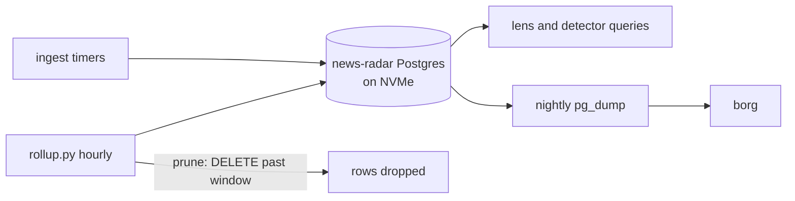
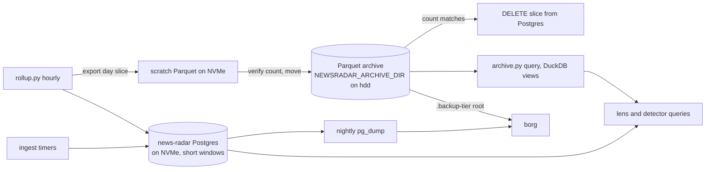

# Archive before prune

Status: proposed 2026-10-18; landed and deployed 2026-10-19 (7448e7d). T57-T65 and T68 pass; T66 and T67 passed live (see Results).

## Why

news-radar's Postgres lives on the NVMe (`news-radar_pgdata`, Docker data
root `/mnt/fast`), and it is now the largest steady grower on that disk.
Retention exists, but `prune()` deletes rows outright, so the only way to keep
history is to keep it in Postgres on the expensive disk. This spec moves
history out to Parquet on the bulk disk before `prune()` deletes it. Nothing
is lost, and the hot windows can then shrink to what the code actually reads.

## Facts measured (2026-10-18)

- `news-radar_pgdata` is 22.7G, up 0.26G in 5 h (about 1.2G/day). Data starts
  2026-09-24, so none of the 90-day windows has filled yet.
- Table sizes: `theme_hourly` 4.6G, `event` 3.7G, `theme_daily` 2.7G,
  `gkg_article` 2.2G, `mention_hourly` 1.1G, `gkg_location` 0.7G,
  `attention_hourly` 0.16G.
- If nothing changes, the 90-day tables reach about 45G around 2026-12-23.
  `theme_daily` is kept forever and grows about 110 MB/day, roughly 40G/yr.
- `/mnt/fast` has about 20G free. `/mnt/hdd` has 587G free. It is SMR, so
  writes need to be large and sequential (hog-disk skill: 6.6 MB/s under
  band rewrites).
- Readers in this repo and their lookbacks:
  - `_ANOMALY` reads `attention_hourly` about 32 days back.
  - `_NAMES` reads `event` 7 days back.
  - The active-event view reads `event` by `added_at` 24 to 72 h, plus a
    60-day UCDP event-date clause.
  - Nothing in the repo reads `theme_hourly` or `mention_hourly`.
  - External lenses (the gdelt skill) may query further back. This spec gives
    them a query path to the archive.
- `rollup.py` runs hourly from the user unit `news-radar-rollup.timer` (`*:10`).
  `prune()` runs all its deletes in one transaction. `--no-prune` must keep
  skipping both archive and delete (CLAUDE.md, Mentions backfill).
- borg finds its roots through `.backup-tier` markers, and
  `offsite-backup/scripts/expected-markers.txt` lists every root it expects.
  A new root on `/mnt/hdd` needs both a marker and a list entry, the same as
  `family-photos`.

## Decisions

1. **Format:** Parquet with zstd compression. There is one file per table per
   UTC day, written as `<table>/<yyyy>/<yyyy-mm-dd>.<n>.parquet`. `n` starts
   at 0. A row that arrives late for a day that is already archived goes into
   the next `n`, so no file is ever rewritten.
2. **Location:** set by the `NEWSRADAR_ARCHIVE_DIR` env var (CLAUDE.md: no host
   paths in core). On hog this is `/mnt/hdd/home/jameson/news-radar-archive`.
   Files are written to `NEWSRADAR_ARCHIVE_SCRATCH` first (default `$TMPDIR`,
   which is on the NVMe), read back to verify, then moved to the archive as one
   sequential copy plus a rename.
3. **No delete without a verified archive.** For each table and day, the delete
   only runs after the file for that slice exists and its row count, read back
   from the file, matches the rows the delete will remove. If archiving fails
   for a table, that table is not pruned this run. The other tables are
   unaffected. The run exits non-zero, which reaches the existing incident
   path as "systemd unit failed". No new notifier.
4. **Each table gets its own transaction** (export, verify, delete), instead of
   today's single transaction around the whole prune. This keeps one failure
   from blocking every table. As built, each (table, day) slice is its own
   REPEATABLE READ transaction, so export and delete see one snapshot and a
   file in the archive always matches a committed delete; a table stops at
   its first failed slice.
5. **Archived tables and new hot windows:**

| Table | Hot window now | Proposed | Why that number |
|---|---|---|---|
| `event` | 90 d | 60 d | the UCDP 60-day event-date clause; `_NAMES` needs 7 d |
| `theme_hourly` | 90 d | 7 d | nothing reads it |
| `mention_hourly` | 90 d | 7 d | nothing reads it |
| `attention_hourly` | 90 d | 35 d | `_ANOMALY` needs about 32 d |
| `wiki_activity` | 90 d | 30 d | views have no time filter; 30 d covers the UI |
| `chatter_hourly` | 90 d | 30 d | same as above |
| `gkg_article` + `gkg_location` | 30 d | 30 d | unchanged, now archived instead of dropped |
| `firms_detection` | 30 d | 30 d | unchanged, now archived |
| `theme_daily` | forever | 180 d | stops the ~40G/yr growth; older data is queryable from the archive |

   **Amendment 1 (2026-10-19):** `event` rows from the `gdacs-alerts` and
   `usgs-volcanoes` sources are neither archived nor pruned. Their `added_at`
   is the upstream start date and the feed keeps serving the item until the
   episode ends, so the old prune deleted 13 live rows every hour, the next
   fetch recreated them (map flicker), and with an archive each would have
   written a new file per hour. They are about 1.2k rows in total.

   `mention`, `wiki_edit`, `chatter_5min`, `bsky_uri` and `attention_anomaly`
   are short-lived scratch buffers. They keep being deleted without an archive.
   This amends `ingestion-expansion.md`, which says `theme_daily` is kept
   forever: it is now kept forever *in the archive*.
6. **Encoding:** `geom` is stored as `lon`/`lat` doubles. `props` and other
   jsonb columns are stored as JSON text. `themes text[]` is stored as a list
   of strings. `gkg_location` is exported in the same slice as its
   `gkg_article` rows, keyed by `article_id`, before the cascade deletes it.
7. **Read path:** `archive.py query "<sql>"` runs DuckDB. Each archived table is
   a view over its Parquet glob, under the same name as the Postgres table, so
   a lens query works unchanged against the archive. The gdelt skill gets a
   short section on how to use it.
8. **Space comes back to the filesystem once.** Plain `VACUUM` only lets
   Postgres reuse the freed space; the files on disk stay the same size. So
   after the first archive pass, a one-off `VACUUM FULL` runs on each shrunk
   table. It takes an exclusive lock for minutes per table, so it runs as a
   script (`scripts/reclaim.sh`) with the ingest timers stopped, not inside
   `rollup.py`.
9. **New dependencies:** `pyarrow` and `duckdb` go into `requirements.txt` and
   `.venv`.

## Requirements

- **R57** Before deleting any row of an archived table (Decision 5), `prune()`
  writes it to a Parquet file under `NEWSRADAR_ARCHIVE_DIR` in the layout from
  Decision 1.
- **R58** A slice is deleted only if its archive file's row count, read back
  from the file, equals the number of rows the delete will remove.
  Otherwise that table is skipped and the process exits non-zero.
- **R59** Each table is archived and pruned in its own transaction. A failure
  on one table does not stop the others.
- **R60** If an archived day receives more rows later, they are written as the
  next `.<n>.parquet` file. Existing files are never modified or deleted.
- **R61** Files are written and verified in scratch, then moved into the
  archive, so the archive never holds a partially written file.
- **R62** If `NEWSRADAR_ARCHIVE_DIR` is unset, `prune()` deletes only the
  scratch buffers and skips every archived table. It never falls back to
  deleting without an archive.
- **R63** `--no-prune` skips both archiving and deleting.
- **R64** The hot windows change to the values in Decision 5.
- **R65** `archive.py query` returns the same rows for a slice as Postgres
  returned before it was archived. Rows include geometry as lon/lat, plus
  jsonb and array columns.
- **R66** The archive directory has a `.backup-tier` marker, is listed in
  `offsite-backup/scripts/expected-markers.txt`, and has its own scan top.
  The next borg run lists it as a root before the first delete under this
  spec happens.
- **R67** `scripts/reclaim.sh` stops the news-radar ingest and rollup timers,
  runs `VACUUM FULL` on the shrunk tables, restarts the timers, and prints
  each table's size before and after.

## Non-goals

- Moving the live Postgres off the NVMe.
- Compacting the per-day files into monthly ones. Do it later if the file
  count ever matters.
- Archiving the scratch buffers listed in Decision 5.
- Any telemetry data (claude-telemetry), which is never deleted.

## Tests

| ID | Req | Test |
|---|---|---|
| T57 | R57 | Fixture rows older than each table's window end up in the expected `<table>/<yyyy>/<day>.0.parquet` and are gone from Postgres. Rows inside the window stay in Postgres. |
| T58 | R58 | With a fault that drops one row from the written file, nothing is deleted for that table and `prune()` reports failure. |
| T59 | R59 | With `event`'s archive failing, `theme_hourly` is still archived and pruned. |
| T60 | R60 | Archive a day, insert a late row for that day, prune again. `.1.parquet` holds only the late row and `.0` is byte-identical. |
| T61 | R61 | A crash injected between write and move leaves no file in the archive dir and no rows deleted. |
| T62 | R62 | With the env var unset, archived tables keep every row and the scratch buffers are still pruned. |
| T63 | R63 | `rollup.py --no-prune` writes no files and deletes nothing. |
| T64 | R64 | The retention constants match Decision 5 (unit test on the table). |
| T65 | R65 | Round trip: fixture rows including `geom`, `props` jsonb and `themes[]`, archived, then read through `archive.py query`. The result equals the rows selected before archiving. |
| T66 | R66 | Live check: `backup-labels.sh roots` includes the archive dir, and the next borg run's root count rises by one. |
| T67 | R67 | Live run of `scripts/reclaim.sh` on hog. The timers are active again afterwards, `news-radar_pgdata` shrinks, and the gain is recorded in this spec. |
| T68 | R64, Amendment 1 | An old `gdacs-alerts` and an old `usgs-volcanoes` event are neither archived nor deleted; an old event from another source is. |

T57-T65 run in the existing `DBCase` suite against a temporary archive dir.
T66 and T67 are live checks done on hog.

### Results (2026-10-19)

- First live pass: 20,803,578 `theme_hourly`, 6,956,667 `mention_hourly` and 291,000 `attention_hourly` rows archived and deleted; 92 Parquet files, 86 MB. DuckDB counts equal the deleted counts, and day spot checks (theme_hourly 2026-10-01, attention_hourly 2026-09-01) match the pre-pass Postgres values exactly. Event, gkg and the rest had nothing due yet.
- T66, first half: `backup-labels.sh roots` lists 44 roots including `/mnt/hdd/home/jameson/news-radar-archive`. Second half passed: the 2026-10-20 03:06 PDT borg run resolved 44 roots with the archive dir among them (audit drift 0), and both the local (03:17) and offsite (03:41) targets succeeded.
- T67: `scripts/reclaim.sh` took 27 s and restarted all five timers. theme_hourly 4879 to 1053 MB, mention_hourly 1091 to 91 MB, attention_hourly 159 to 48 MB; database 21 to 16 GB; `news-radar_pgdata` 23.71 to 18.53 GB; `/mnt/fast` free 16 to 21 GB.

## Architecture

### Before

### After

