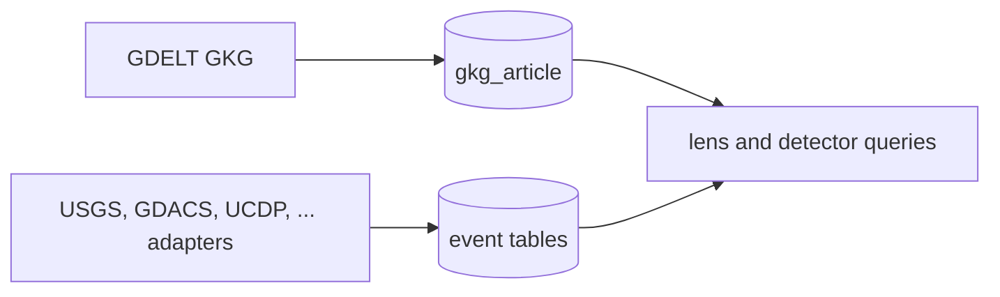
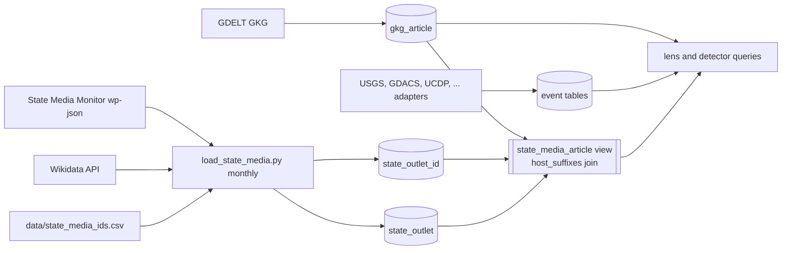

# State media registry

Status: landed 2026-10-11. Extends `specs/ingestion-expansion.md`;
requirement and test numbers continue after `specs/conflict-sources.md`.

## Why

The store cannot say which of its outlets a government runs. That is the
first thing needed to watch state propaganda: what state outlets cover, how
that differs from everyone else, and where they publish outside GDELT's
reach. This spec adds the label and the identifiers only. Collecting from
Telegram or YouTube is the next spec, and it starts from R43's report.

A label is not a judgment in the R1 sense: nothing is scored or dropped, and
every typology is stored, including editorially independent public
broadcasters. Which typologies count as "state media" is a WHERE clause in
the lens, not a filter at load.

## Facts measured 2026-09-30

- **State Media Monitor** (Media and Journalism Research Center, CC BY 4.0)
  classifies outlets into SC (state-controlled), CaPu (captured public),
  CaPr (captured private) and the independent ISF, ISM, ISFM, IP types,
  with a 2022 to 2026 trajectory per outlet. The Zenodo record holds only a
  README; the data is the website.
- Three regional pages (Eurasia, Asia, MENA) embed a `const DATA = [...]`
  JSON array: 249 outlets, 57 countries, 236 of them SC, CaPu or CaPr.
  Europe, Africa and the Americas are prose. About 147 outlets across all
  regions have newer profile pages whose text opens
  `<Country> · Quick Facts <CODE>`. Some outlets exist only as prose, and
  some are absent (KCNA).
- The site is WordPress; `/wp-json/wp/v2/posts` lists all 663 posts.
- SMM gives organisations and asset names, never hostnames or handles.
- `gkg_article.site` is the full hostname (`english.news.cn`, not
  `news.cn`), so matching must be by domain suffix.
- In 7 days of GKG: chinadaily.com.cn 1292 articles, english.news.cn 1243,
  aa.com.tr 548, aljazeera.com 425, sputnikglobe.com 149, globaltimes.cn
  128, rt.com 19. tass.ru, presstv.ir, cgtn.com, irna.ir and kcna.kp: zero.

## Requirements

- **R39 Outlet registry.** `scripts/load_state_media.py` loads every outlet
  from the regional `DATA` arrays and from profile pages carrying a Quick
  Facts code, into `state_outlet` (country, name, region, typology,
  trajectory, assets, smm_url, first_seen, last_seen). A DATA row wins over
  a profile row for the same outlet, meaning the same country and a shared
  normalised name variant (full name, the part before a parenthesis, or the
  acronym inside it). A subnational profile (`Spain · Catalonia`) stores
  the second part as `region`. An outlet that disappears
  from SMM keeps its row with a stale `last_seen`; nothing is deleted.
  Refreshed by `news-radar-monthly.timer`.
- **R40 Identifiers from Wikidata.** For each outlet, find its Wikidata item
  by name (each name variant, search limit 15, network errors retried with
  backoff) with the outlet's country (P17) as a constraint: the country
  item's ISO code (P297) equals the outlet's, from `country_code` or a small
  map for SMM's own spellings, or its label or alias equals SMM's country
  name. Several in-country candidates narrow to those whose label or alias
  equals a name variant exactly. Take official
  website (P856), Telegram username (P3789), YouTube channel (P2397) and X
  username (P2002), also from subsidiaries (P355). Stored in
  `state_outlet_id` (outlet, kind host|telegram|youtube|x, value, origin,
  qid). A search with zero or several candidates in the country stores
  nothing and leaves the outlet unmatched. A wrong match is worse than a
  missing one.
- **R41 Manual identifiers.** `data/state_media_ids.csv`, committed, adds
  identifiers for sub-brands (actualidad.rt.com, sputnikglobe.com) and for
  outlets Wikidata misses. Manual rows are never overwritten or removed by
  a refresh.
- **R42 Host matching.** A hostname belongs to an outlet when it equals a
  registered host or is a subdomain of one, compared on labels
  (`english.news.cn` matches `news.cn`; `fakenews.cn` does not).
  View `state_media_article` joins `gkg_article` to its outlet, carrying
  typology, so the lens filters on it.
- **R43 Coverage report.** `load_state_media.py --report` lists outlets
  with no host and registered hosts with no GKG article in 7 days. It is
  the input to the collection spec.
- **R44 Skill.** `.claude/skills/state-media-monitor/SKILL.md` per R34. The
  README credits MJRC under CC BY 4.0 and Wikidata (CC0).

## Non-goals

- No Telegram, YouTube or X collection.
- No classification of our own; SMM's typology is the only label.
- No detector or map change.

## Schema

```sql
CREATE TABLE state_outlet (
    id         SERIAL PRIMARY KEY,
    country    TEXT NOT NULL,
    name       TEXT NOT NULL,
    region     TEXT,
    typology   TEXT NOT NULL,          -- SC, CaPu, CaPr, ISF, ISM, ISFM, IP
    trajectory TEXT[] NOT NULL,        -- 2022..2026, '-' where unrated
    assets     TEXT,
    smm_url    TEXT NOT NULL,
    first_seen DATE NOT NULL,
    last_seen  DATE NOT NULL,
    UNIQUE (country, name)
);
CREATE TABLE state_outlet_id (
    outlet_id INT  NOT NULL REFERENCES state_outlet(id),
    kind      TEXT NOT NULL,           -- host, telegram, youtube, x
    value     TEXT NOT NULL,           -- hosts lowercased, no www.
    origin    TEXT NOT NULL,           -- wikidata, manual
    qid       TEXT,
    PRIMARY KEY (kind, value)
);
```

## Tests

| ID | Req | Test |
|---|---|---|
| T36 | R39 | A fixture regional page yields outlets with typology and trajectory, a null year stored as `-`; a fixture profile page yields its Quick Facts code; a profile row for an outlet already in DATA is ignored |
| T37 | R39 | Loading the same fixtures twice inserts nothing; an outlet absent from the second load keeps its row and its old `last_seen` |
| T38 | R40 | A fixture Wikidata response stores host, telegram and youtube rows with the qid, `www.` stripped; a search with two in-country candidates stores nothing and the outlet appears unmatched |
| T39 | R41 | A manual row survives a refresh whose Wikidata answer differs |
| T40 | R42 | `english.news.cn` matches `news.cn`; `fakenews.cn` and `news.cn.example.org` do not |
| T41 | R43 | The report lists an outlet with no host and a host with no recent article |
| T42 | R44 | The skill exists with its frontmatter name and names both the SMM and Wikidata endpoints |

## Architecture

### Before



### After



## Results 2026-10-11

- 310 outlets in 79 countries after dedupe (333 before).
- Wikidata matched 188 of 310 (655 identifiers); the strict
  country-label rule alone matched 132. Hosts by typology: SC 100/183,
  CaPu 30/56, CaPr 9/23.
- 15 manual rows (Xinhua, China Daily, CMG, Rossiya Segodnya, TASS, IRIB,
  WAM). GKG over 7 days then gives SC 2808 articles from 13 outlets, CaPu
  1531 from 3. rt.com, tass.ru, presstv.ir and irna.ir stay near zero:
  a GDELT gap, which the collection spec addresses.

## Assumptions stated

- Wikidata matches most SC and CaPu outlets by name. Not measured; R43's
  report will say how many it misses.
- Scraping SMM's pages monthly is acceptable use of a CC BY dataset that
  publishes no bulk file. If MJRC publishes one, switch to it.
