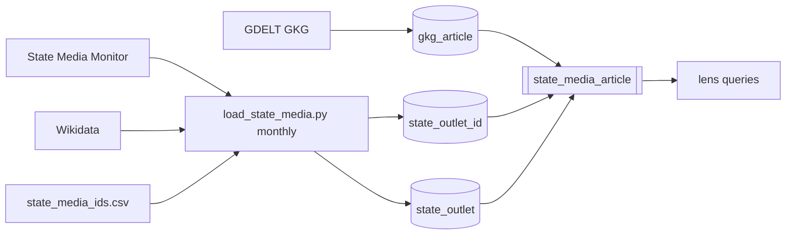
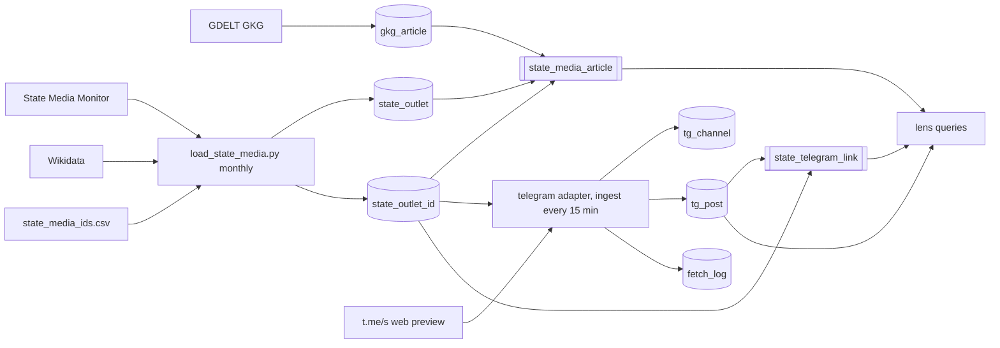

# State media on Telegram

Status: proposed 2026-10-11. Extends `specs/state-media.md`; requirement and
test numbers continue after it.

## Why

GDELT barely sees Russian and Iranian state output: rt.com, tass.ru,
presstv.ir and irna.ir are near zero in a week of GKG. Those outlets publish
first and most on Telegram. This spec collects the public posts of the
registry's Telegram channels, so the store holds what state outlets say,
in their own words, when they say it.

## Facts measured 2026-10-11

- The registry holds 54 Telegram handles: SC 31, CaPu 15, CaPr 2, ISFM 6.
  Some are bots (`ruptlybot`, `uza_ovoz_bot`, `uza yukla bot`, which is not
  even a valid handle) and some are Gazprom Media entertainment channels
  (`comedyclubru`, `tnt_television`, `match_tv`).
- Big channels are missing because their outlet's Wikidata item has no
  P3789: RIA (`rian_ru`), Press TV (`presstv`), IRNA (`irna_1313`).
- `https://t.me/s/<handle>` serves the channel's public web preview with no
  account or key: 20 posts per page, each with `data-post="<handle>/<id>"`,
  `<time datetime>`, text, view count, forward source and links. Older
  pages come from `?before=<id>`, which reached a day back for TASS.
- Some channels answer 302 to `https://t.me/<handle>` instead, meaning
  their preview is off or restricted: `rt_russian`, `rtnews`. Their posts
  are reachable only through the logged-in MTProto API, which needs a
  phone-number account.
- Rates: TASS about 20 posts an hour (`tass_agency/399792` is a running
  id); RIA, Press TV, IRNA and BelTA each fill a 20-post page in 2 to 6
  hours.

## Decisions in this spec (assumed, change before execute)

- **Post text is stored.** This breaks the R31 rule that chatter keeps
  counts, never content. The rule exists to keep third-party text out of a
  content-blind detector; here the text is the object of study, and these
  are public broadcasts by governments, not private users. Scope stays
  narrow: only channels in `state_outlet_id`.
- **Kept indefinitely.** At about 50 channels and under 10 MB of text a
  day, a year is a few GB. Narrative history is the point.
- **Web preview only, no account.** Channels without a preview are
  reported, not collected. MTProto with an account is a separate decision.

## Requirements

- **R45 Channel list.** Collected channels are `state_outlet_id` rows with
  `kind = 'telegram'` and a valid handle (`^[A-Za-z][A-Za-z0-9_]{3,31}$`,
  not ending in `bot`), for every typology. The lens filters on typology,
  not the collector. `data/state_media_ids.csv` gains `rian_ru`,
  `presstv`, `irna_1313` and other handles found missing.
- **R46 Collector.** `newsradar/adapters/telegram.py`, run every 15
  minutes from `news-radar-ingest.service` as its own `ExecStart=-` line.
  Per channel: fetch `t.me/s/<handle>`, then `?before=` pages until a post
  already stored or one older than 7 days. One request per second, the
  same User-Agent as the Wikidata client. A post seen again updates its
  views and edited text.
- **R47 Storage.** `tg_channel(handle PK, outlet_id, title, subscribers,
  preview BOOL, checked_at)` and `tg_post(handle, post_id, posted_at,
  text, views, forwarded_from, links TEXT[], media TEXT[], first_seen,
  last_seen, PRIMARY KEY (handle, post_id))`. Views parsed from `34.9K`
  style counts into integers.
- **R48 Unreachable channels.** A 302 sets `preview = false` and is
  retried once a day, not every run. `load_state_media.py --report` gains
  a third section: handles with no preview and handles with no post in 7
  days.
- **R49 Link lens.** View `state_telegram_link` unnests `tg_post.links`
  and joins their hosts to `state_outlet_id` through `host_suffixes()`, so
  a post linking to another state outlet's site shows both outlets.
- **R50 Health and skill.** Each run writes one `fetch_log` row per
  channel (R32). `.claude/skills/telegram/SKILL.md` per R34. README notes
  the content exception and its scope.

## Non-goals

- No MTProto, no account, no YouTube or X.
- No comments, reactions beyond views, or media downloads (media stays as
  URLs).
- No translation, embedding or model call.

## Schema

```sql
CREATE TABLE tg_channel (
    handle      TEXT PRIMARY KEY,
    outlet_id   INT REFERENCES state_outlet(id),
    title       TEXT,
    subscribers INT,
    preview     BOOLEAN NOT NULL,
    checked_at  TIMESTAMPTZ NOT NULL
);
CREATE TABLE tg_post (
    handle         TEXT        NOT NULL REFERENCES tg_channel(handle),
    post_id        BIGINT      NOT NULL,
    posted_at      TIMESTAMPTZ NOT NULL,
    text           TEXT,
    views          INT,
    forwarded_from TEXT,
    links          TEXT[]      NOT NULL DEFAULT '{}',
    media          TEXT[]      NOT NULL DEFAULT '{}',
    first_seen     TIMESTAMPTZ NOT NULL,
    last_seen      TIMESTAMPTZ NOT NULL,
    PRIMARY KEY (handle, post_id)
);
CREATE INDEX ON tg_post (posted_at);
```

## Tests

| ID | Req | Test |
|---|---|---|
| T43 | R45 | Bot handles and invalid handles are excluded; a manual telegram row is included |
| T44 | R46, R47 | A fixture preview page yields 20 posts with id, time, text, integer views, forward source and links; `34.9K` parses to 34900 |
| T45 | R46 | Paging stops at the first stored post and at the 7-day bound; a fake fetch counts requests |
| T46 | R46 | A post seen again updates views and text, keeps `first_seen` |
| T47 | R48 | A 302 marks the channel `preview = false` and it is skipped until a day has passed; the report lists it |
| T48 | R49 | A post linking `english.news.cn/x` joins to the outlet owning `news.cn`; `fakenews.cn` does not |
| T49 | R50 | One `fetch_log` row per channel per run; the skill exists and names `https://t.me/s/` |

## Architecture

### Before



### After


