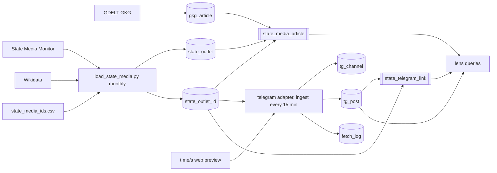
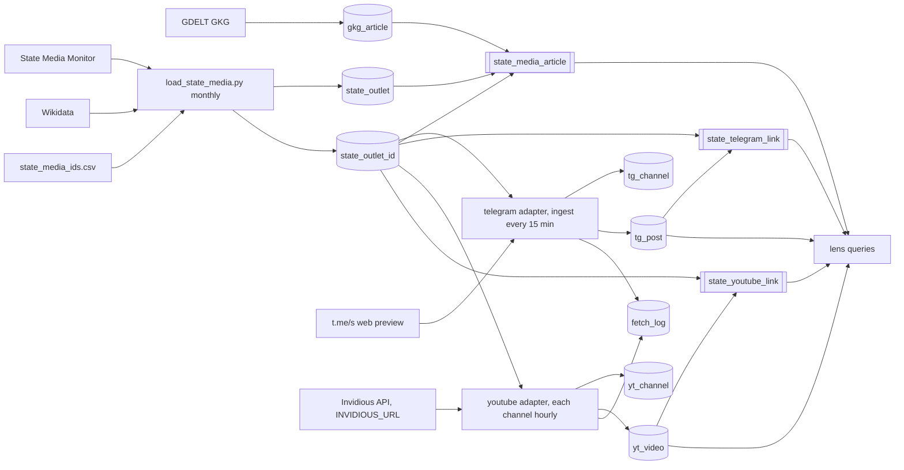

# State media on YouTube

Status: proposed 2026-10-11. Extends `specs/state-media.md` and
`specs/state-telegram.md`; requirement and test numbers continue after them.
Homelab #310.

## Why

The registry holds 97 YouTube channels, and broadcasters publish more there
than anywhere else: Yonhap, PTV, Al Jazeera and ERT each upload 60 to 110
videos a day. This spec collects what each registry channel uploads (title,
description, time, length, views), so the store can compare what state
outlets put on YouTube with what they put on their sites and Telegram.

## Facts measured 2026-10-11

- 97 `state_outlet_id` rows with `kind = 'youtube'`, all `UC...` channel
  ids: SC 36, ISFM 24, CaPu 23, IP 8, CaPr 4, ISM 2.
- YouTube's keyless channel feed (`/feeds/videos.xml?channel_id=`)
  answered 404 or 500 for all 97, and 404 for Google's own developer
  channel. Feed readers report it flaky since December 2025 (miniflux,
  n8n, NewsBlur threads). It cannot be the source.
- An Invidious instance's `/api/v1/channels/<id>/videos` (InnerTube behind
  it, no key) answered for all 97. 85 are live and 12 are gone: 6
  "terminated for a violation of YouTube's Terms of Service" (RT among
  them), 2 removed for Community Guidelines, 2 "not available", 1 does not
  exist, 1 terminated after copyright claims. Dead by typology: SC 7,
  CaPu 3, CaPr 2.
- The list call returns the 60 most recent uploads with title, video id,
  approximate publish time ("16 hours ago" resolved to a timestamp), views
  and length. Description is empty there; `/api/v1/videos/<id>` has it,
  along with an exact publish time and keywords.
- 69 channels uploaded in the last 7 days, about 1,200 videos a day in
  total. The busiest (Yonhap at 111 a day) fills 60 entries in 13 hours.

## Decisions in this spec (assumed, change before execute)

- **Invidious, not the feed and not the Data API.** No key and no quota,
  and the instance already runs here. Core reads `INVIDIOUS_URL` from the
  environment, so nothing host-specific lands in the open-source code;
  anyone can point it at their own instance. Without it the collector logs
  once and does nothing.
- **Hourly per channel.** 60 entries cover at least 13 hours for the
  busiest channel, so an hour is safe. That comes to about 2,000 list calls
  and 1,200 detail calls a day, at one request a second.
- **Risk: the household instance shares the load.** If YouTube throttles
  the Invidious companion, playback on yt.jameson.casa suffers too. R56
  stops the run on the first 429 or 403, and the hourly cadence keeps the
  load at about a request every 27 seconds on average.
- **Titles and descriptions are stored, indefinitely.** This is the same
  content exception as Telegram (R31 vs. state-telegram decisions), with
  the same scope: registry channels only. At about 1,200 videos a day with
  descriptions averaging under 1 KB, a year is well under 1 GB.
- **No transcripts, thumbnails, comments or media.**

## Requirements

- **R51 Channel list.** Collected channels are `state_outlet_id` rows with
  `kind = 'youtube'` matching `^UC[A-Za-z0-9_-]{22}$`, for every typology.
- **R52 Collector.** `newsradar/adapters/youtube.py`, run by
  `scripts/collect_youtube.py` from `news-radar-ingest.service` as its own
  `ExecStart=-` line. A channel is due when its `checked_at` is over 55
  minutes old. Per due channel: fetch the list; for each video id not yet
  stored, fetch its detail. One request per second, the Wikidata client's
  User-Agent.
- **R53 Storage.** `yt_channel` and `yt_video` per the schema below. A
  video seen again updates `views`, `title` and `last_seen`, keeps
  `first_seen` and `published_at`. `published_at` comes from the detail
  call; the list's approximate time is used only if the detail fails, and
  `published_exact` says which.
- **R54 Gone channels.** An Invidious error naming termination, removal,
  unavailability or non-existence sets `status` to `gone` with the message
  in `reason`; a gone channel is retried once a week. Any other error
  leaves `status` alone and is logged. `load_state_media.py --report` gains
  a fourth section: gone YouTube channels and live ones with no upload in
  7 days.
- **R55 Link lens.** View `state_youtube_link` extracts URLs from
  `yt_video.description`, and joins their hosts to `state_outlet_id`
  through `host_suffixes()`, as R49 does for Telegram.
- **R56 Health, back-off and skill.** One `fetch_log` row per channel per
  hour (file `<channel_id>/<YYYY-MM-DDTHH>`, upserted). An HTTP 429 or 403
  from Invidious ends the run and records it in `fetch_log`; the next run
  starts over. A channel that errors otherwise is logged and the rest still
  run. `.claude/skills/youtube/SKILL.md` per R34 names `INVIDIOUS_URL` and
  the two endpoints. The README's content-exception note covers YouTube.
  `.env` on this host sets `INVIDIOUS_URL=http://127.0.0.1:3088`.

## Non-goals

- No YouTube Data API, no key, no feed fallback.
- No transcripts, captions, thumbnails, comments or downloads.
- No translation, embedding or model call.
- No YouTube channels beyond the registry.

## Schema

```sql
CREATE TABLE yt_channel (
    channel_id  TEXT PRIMARY KEY,
    outlet_id   INT REFERENCES state_outlet(id),
    title       TEXT,
    subscribers INT,
    status      TEXT        NOT NULL CHECK (status IN ('live', 'gone')),
    reason      TEXT,
    checked_at  TIMESTAMPTZ NOT NULL
);
CREATE TABLE yt_video (
    video_id        TEXT PRIMARY KEY,
    channel_id      TEXT        NOT NULL REFERENCES yt_channel(channel_id),
    published_at    TIMESTAMPTZ NOT NULL,
    published_exact BOOLEAN     NOT NULL,
    title           TEXT        NOT NULL,
    description     TEXT,
    keywords        TEXT[]      NOT NULL DEFAULT '{}',
    length_s        INT,
    views           BIGINT,
    live            BOOLEAN     NOT NULL DEFAULT false,
    first_seen      TIMESTAMPTZ NOT NULL,
    last_seen       TIMESTAMPTZ NOT NULL
);
CREATE INDEX ON yt_video (published_at);
CREATE INDEX ON yt_video (channel_id, published_at);
```

## Tests

| ID | Req | Test |
|---|---|---|
| T50 | R51 | A non-`UC` value is excluded; a manual youtube row is included |
| T51 | R52, R53 | A fixture list and detail yield a video with exact time, description, keywords, length and integer views; a failed detail stores the list time with `published_exact = false` |
| T52 | R52 | A channel checked 30 minutes ago is skipped; only unseen video ids get a detail call (a fake fetch counts requests) |
| T53 | R53 | A video seen again updates views and title, keeps `first_seen` and `published_at` |
| T54 | R54 | A termination error marks the channel `gone` with its reason and skips it until a week has passed; the report lists it |
| T55 | R55 | A description linking `english.news.cn/x` joins to the outlet owning `news.cn`; `fakenews.cn` does not |
| T56 | R56 | A 429 stops the run after that request and writes a `fetch_log` row; unset `INVIDIOUS_URL` makes no request; the skill exists and names `/api/v1/channels/` |

## Architecture

### Before



### After


